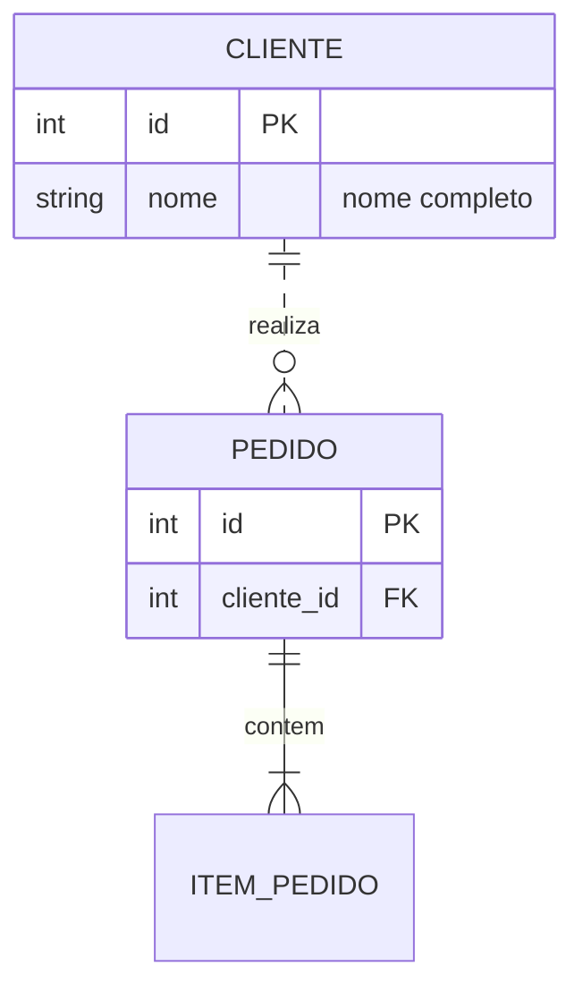

# Guia de estudo e implementação — Modelagem ER Acessível

Este guia reúne o que já está definido para que a equipe possa estudar e implementar o projeto sem confundir funcionalidades planejadas com código existente.

## 1. O que o projeto resolve

A aplicação recebe um texto Mermaid `erDiagram` e cria duas representações do mesmo diagrama:

1. uma representação semântica navegável por teclado e leitor de tela;
2. uma representação visual em SVG, complementar e sincronizada.

O problema não é apenas desenhar entidades e linhas. Um SVG comum não fornece uma ordem de exploração útil nem explica quais elementos estão conectados. Por isso o dado estruturado, e não o SVG, é a fonte de verdade.

```text
Código Mermaid
      ↓
Parser TypeScript (sem React)
      ↓
Modelo ER validado: entidades + atributos + relacionamentos
      ├── árvore ARIA e detalhes textuais
      ├── narração e sinais complementares
      ├── SVG
      └── exportação Markdown
```

O fluxo acima é um requisito arquitetural. As saídas nunca devem tentar extrair informação do SVG.

## 2. O que existe hoje e o que ainda será implementado

Existe:

- React, Vite, TypeScript, Tailwind e Vitest configurados;
- diretórios `src/core/` e `src/ui/`, ainda vazios;
- a especificação do subconjunto em `docs/gramatica-er.md`;
- contexto funcional e requisitos do TCC em `docs/CONTEXTO_tcc.md`.

Ainda não existe:

- parser ER;
- tipos do modelo de domínio;
- testes do parser;
- árvore WAI-ARIA;
- renderizador SVG próprio;
- Web Speech API, sons ou exportação Markdown;
- integração com Mermaid como biblioteca de renderização.

## 3. Escopo da entrada

O MVP aceita somente o subconjunto descrito em `gramatica-er.md`. Ele suporta:

- cabeçalho `erDiagram`;
- comentários de linha `%%` e linhas em branco;
- entidades com ou sem atributos;
- atributos com tipo, nome, PK, FK, UK e comentário opcional;
- relacionamentos com cardinalidades crow's foot, ligação identificadora ou não identificadora e rótulo;
- autorrelacionamentos e relações múltiplas.

Recursos Mermaid que não estão nesse documento — aliases, configurações visuais, tipos complexos, cardinalidade textual e nomes Unicode sem aspas, por exemplo — devem gerar erro claro, e não ser aceitos parcialmente.

Exemplo aceito:



## 4. Conceitos de domínio

| Conceito | Significado | Exemplo |
|---|---|---|
| Entidade | conceito do domínio; pode ter atributos | `CLIENTE` |
| Atributo | propriedade de uma entidade | `string nome` |
| Chave | marca semântica do atributo | `PK`, `FK`, `UK` |
| Relacionamento | ligação entre duas entidades | `CLIENTE ... PEDIDO : realiza` |
| Cardinalidade | mínimo e máximo em uma extremidade | `||`, `o{` |
| Ligação | informa se a relação é identificadora | `--` ou `..` |

As cardinalidades reconhecidas são:

| Marcador à esquerda | Marcador à direita | Valor semântico |
|---|---|---|
| `||` | `||` | exatamente um |
| `|o` | `o|` | zero ou um |
| `}|` | `|{` | um ou muitos |
| `}o` | `o{` | zero ou muitos |

Uma relação como `CLIENTE ||..o{ PEDIDO : realiza` é não identificadora e pode ser descrita como “Cliente realiza zero ou muitos pedidos; cada pedido está associado a exatamente um cliente”. Para evitar inversões, o modelo guarda as cardinalidades pelas posições esquerda e direita da linha original.

## 5. Modelo TypeScript proposto

Estes tipos são uma proposta para `src/core/model.ts`; não são código já implementado.

```ts
export type Cardinality =
  | 'exactlyOne'
  | 'zeroOrOne'
  | 'oneOrMany'
  | 'zeroOrMany';

export type AttributeKey = 'PK' | 'FK' | 'UK';
export type RelationshipKind = 'identifying' | 'nonIdentifying';
export type RelationshipClassification =
  | 'oneToOne'
  | 'oneToMany'
  | 'manyToOne'
  | 'manyToMany';

export interface Attribute {
  readonly type: string;
  readonly name: string;
  readonly keys: readonly AttributeKey[];
  readonly comment?: string;
  readonly line: number;
}

export interface Entity {
  readonly name: string;
  readonly attributes: readonly Attribute[];
  readonly firstMentionLine: number;
  readonly declarationLine?: number;
}

export interface Relationship {
  readonly leftEntity: string;
  readonly rightEntity: string;
  readonly leftCardinality: Cardinality;
  readonly rightCardinality: Cardinality;
  readonly kind: RelationshipKind;
  readonly classification: RelationshipClassification;
  readonly label: string;
  readonly line: number;
}

export interface Diagram {
  readonly headerLine: number;
  readonly entities: readonly Entity[];
  readonly relationships: readonly Relationship[];
}

export interface ParseError {
  readonly code: string;
  readonly message: string;
  readonly line: number;
}

export interface ParseResult {
  readonly diagram?: Diagram;
  readonly errors: readonly ParseError[];
}
```

Decisões importantes:

- `Relationship` é uma coleção separada, pois o diagrama é um grafo, não uma árvore.
- `Entity.attributes` pode ser vazio.
- atributos e relacionamentos guardam linha para erros e sincronização futura;
- `Diagram` só é fornecido quando não há erros; a interface não deve renderizar modelo parcial como se fosse válido;
- arrays e propriedades `readonly` impedem mutações acidentais entre parser e interface.

## 6. Como o parser pode ser organizado

Arquivos sugeridos, todos em `src/core/`:

```text
core/
├── model.ts          # tipos do domínio
├── parser.ts         # função pública parseErDiagram
├── lexer.ts          # auxiliares de linha e texto entre aspas
├── validators.ts     # identificadores, chaves e cardinalidades
└── parser.test.ts    # testes Vitest
```

A API inicial pode ser:

```ts
export function parseErDiagram(source: string): ParseResult;
```

Algoritmo recomendado:

1. dividir o texto em linhas, preservando a numeração original;
2. ignorar linhas em branco e comentários completos;
3. localizar e validar `erDiagram` como primeira linha útil;
4. percorrer as outras linhas com o estado `foraDoBloco` ou `dentroDoBloco`;
5. fora do bloco, reconhecer entidade isolada, início de bloco ou relacionamento;
6. dentro do bloco, reconhecer atributo ou `}`;
7. validar duplicidades e guardar dados em mapas internos;
8. ao final, verificar bloco aberto e produzir `Diagram` apenas se não houve erro.

Estado mínimo:

```ts
type ParserState =
  | { readonly kind: 'outside' }
  | { readonly kind: 'insideEntity'; readonly entityName: string; readonly openedAtLine: number };
```

Use `Map<string, Entity>` internamente para reunir referências e blocos da mesma entidade, mas converta ao tipo público no final. Não importe React, componentes, `window` ou APIs de navegador nesse núcleo.

## 7. Validações e erros

Cada erro tem código, linha e mensagem compreensível. A especificação já enumera E01 a E14. Os testes devem verificar o código e a linha, não depender somente do texto da mensagem.

Casos indispensáveis:

- cabeçalho ausente ou após uma instrução;
- identificador inválido;
- abertura/fechamento incorreto de bloco;
- bloco vazio ou repetido;
- atributo sem tipo/nome, repetido ou com chave inválida/repetida;
- relação sem rótulo, com operador inválido ou aspas não fechadas;
- recurso Mermaid fora do MVP;
- entidade declarada isoladamente, em relacionamento e posteriormente em bloco;
- autorrelacionamento e relações repetidas.

O parser pode acumular erros de linhas independentes. Porém, se há erros, não deve entregar um diagrama semântico como válido.

## 8. Testes antes da interface

Cada regra de gramática merece ao menos um teste válido e um inválido. Um esqueleto de teste:

```ts
import { describe, expect, it } from 'vitest';
import { parseErDiagram } from './parser';

describe('parseErDiagram', () => {
  it('cria entidades e relacionamento com cardinalidades', () => {
    const result = parseErDiagram(`erDiagram
      CLIENTE ||..o{ PEDIDO : realiza`);

    expect(result.errors).toEqual([]);
    expect(result.diagram?.relationships[0]).toMatchObject({
      leftEntity: 'CLIENTE',
      rightEntity: 'PEDIDO',
      kind: 'nonIdentifying',
    });
  });
});
```

Além de testes unitários, manter exemplos completos em arquivos de teste facilita validar narração e árvore quando essas camadas existirem.

## 9. Como o modelo vira uma experiência acessível

O grafo não deve ser apresentado como uma lista sem contexto. Uma primeira projeção possível é:

```text
Diagrama
├── Entidades
│   └── CLIENTE
│       ├── Atributos
│       │   ├── id — inteiro, chave primária
│       │   └── nome — texto
│       └── Relacionamentos
│           └── realiza PEDIDO — zero ou muitos
└── Relacionamentos
    └── CLIENTE realiza PEDIDO — não identificador
```

Essa é uma projeção do mesmo `Diagram`, não outro banco de dados. A seção por entidade favorece exploração local; a seção global permite comparar relações. A repetição é intencional e deve apontar para o mesmo relacionamento.

Ao implementar o componente, seguir o padrão WAI-ARIA Treeview:

- `Tab` entra e sai do componente;
- setas movimentam o foco e expandem/recolhem nós;
- `Home` e `End` vão ao primeiro e último item visível;
- `Enter` executa a ação definida;
- foco e seleção são estados diferentes;
- o SVG deve destacar o item focado, mas não ser a única forma de obter informação.

## 10. Narração, sons e SVG

A Web Speech API é complementar ao leitor de tela. A interface deve funcionar se a narração estiver desligada ou indisponível. Uma fala curta ao focar uma relação pode ser:

> “Relação: cliente realiza pedido. Não identificadora. Para cada cliente, zero ou muitos pedidos.”

Sons não podem ser a única indicação de cardinalidade. Todo sinal precisa de equivalente textual.

O SVG será produzido do `Diagram` e deverá permitir foco visível, alto contraste e zoom. Quando um item da árvore recebe foco, o SVG destaca sua entidade ou relação; quando um elemento visual é selecionado, a árvore deve receber atualização equivalente.

## 11. Ordem segura de desenvolvimento

1. fechar a gramática e revisar exemplos;
2. criar o modelo TypeScript;
3. implementar parser e testes de erros;
4. criar descrição textual e árvore simples, sem SVG;
5. testar navegação por teclado e NVDA;
6. adicionar SVG sincronizado;
7. adicionar narração, sons e exportação;
8. testar WCAG, axe-core e casos reais de usuários.

## 12. Fontes para estudo

- [Contexto do TCC](./CONTEXTO_tcc.md)
- [Gramática do MVP](./gramatica-er.md)
- [Sintaxe ER oficial do Mermaid](https://mermaid.js.org/syntax/entityRelationshipDiagram.html)
- [Padrão WAI-ARIA Treeview](https://www.w3.org/WAI/ARIA/apg/patterns/treeview/)
- [Discussão de acessibilidade do Mermaid](https://github.com/mermaid-js/mermaid/issues/5632)
- [TADA: diagramas acessíveis por áudio e toque](https://arxiv.org/abs/2311.04502)
- [Data Navigator: navegação acessível de estruturas de dados](https://arxiv.org/abs/2308.08475)

As fontes externas são referências de decisão; o contrato implementável do MVP é sempre a gramática versionada neste repositório.
